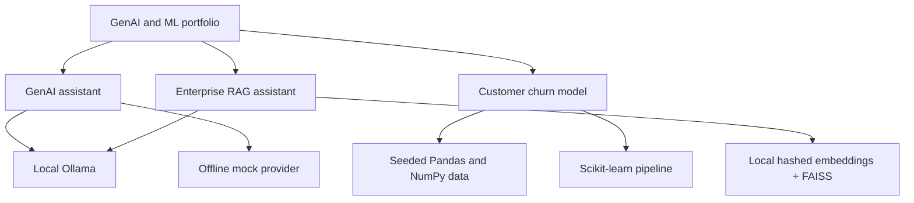

# GenAI and Machine Learning Portfolio

Three independent, Windows-runnable Python portfolio projects. Each folder has its own application code, tests, `requirements.txt`, `.env.example`, `.gitignore`, README, and GitHub publishing instructions so it can become a separate repository without extracting shared files.

## Projects

| Project | What it demonstrates | Local entry point |
| --- | --- | --- |
| [GenAI Assistant](genai-assistant/README.md) | LangChain prompt engineering, local Ollama or mock chat, FastAPI, Streamlit, bounded LLM settings, and error handling | FastAPI on `8000`; Streamlit on `8501` |
| [Customer Churn Signals](ml-predictor/README.md) | Reproducible synthetic data, preprocessing, scikit-learn training, holdout metrics, feature importance, and interactive scoring | Streamlit on `8501` |
| [Knowledge Desk RAG](rag-assistant/README.md) | PDF/TXT ingestion, chunking, Ollama or local embeddings, FAISS retrieval, cited answers, and recall@k evaluation | Streamlit on `8501` |

## Portfolio architecture



## Windows setup

Use Python 3.10 or newer and PowerShell. Create a separate virtual environment in each project; each project README has exact commands. Example for the GenAI project:

```powershell
cd C:\Test_AI\GenAI-Portfolio\genai-assistant
py -3.12 -m venv .venv
.\.venv\Scripts\Activate.ps1
pip install -r requirements.txt
Copy-Item .env.example .env
python -m pytest
```

Repeat with `ml-predictor` and `rag-assistant`. The ML application is fully offline. GenAI and RAG use Ollama locally when available and have mock/extractive fallbacks; no API credentials are needed. Install Ollama and pull `llama3.2:latest` for local generated answers. Each app README includes its exact run command and environment variables.

## Validation

The project test suites are designed to run offline. The implementation was exercised with Python 3.14.3: ML pipeline tests passed (3), GenAI service/API tests passed (6), and RAG ingestion/retrieval/evaluation tests passed (6). A live `llama3.2:latest` request succeeded through both the GenAI API and RAG service. The ML model's measured synthetic holdout accuracy was `0.720` (150 rows); RAG sample recall@3 was `1.00` across three queries against one handbook. These are demo checks, not production performance claims.

## Publish separately

Create three empty GitHub repositories, one per project. From each project folder, follow its README's `git init`, `git add`, `git commit`, `git remote add`, and `git push` instructions, substituting your repository URL. Review staged files and confirm `.env` is not included before committing. No GitHub repositories were created and nothing was pushed.

The workspace machine used to build this portfolio did not have Git installed, so Git commands and remote publishing were not run here.