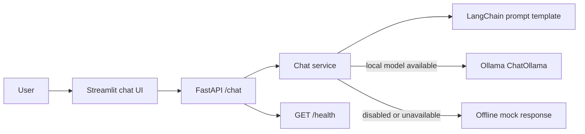

# GenAI Assistant

A prompt-driven chat application with a FastAPI backend, LangChain prompt templates, and a Streamlit chat UI. It uses a local Ollama model when the Ollama server is available. If Ollama is disabled or unavailable, it returns a deterministic mock response, so the API and interface work without cloud services or credentials.

## Architecture



## Windows setup

Use two PowerShell terminals from this project folder:

```powershell
cd C:\Test_AI\GenAI-Portfolio\genai-assistant
py -3.12 -m venv .venv
.\.venv\Scripts\Activate.ps1
python -m pip install --upgrade pip
pip install -r requirements.txt
Copy-Item .env.example .env
python -m pytest
```

Install [Ollama for Windows](https://ollama.com/download) and download the default model:

```powershell
ollama pull llama3.2:latest
```

Start the API in terminal 1:

```powershell
uvicorn assistant_app.main:app --reload
```

Start the UI in terminal 2:

```powershell
streamlit run assistant_app\ui.py
```

The API docs are at `http://127.0.0.1:8000/docs`; the UI URL is printed by Streamlit (normally `http://localhost:8501`). Python 3.10 or newer is required. If PowerShell blocks activation, prefix commands with `.venv\Scripts\python.exe -m` (for example, `.venv\Scripts\python.exe -m uvicorn assistant_app.main:app --reload`).

## Ollama configuration

Ollama runs locally and does not need an API key. Set `OLLAMA_BASE_URL`, `OLLAMA_MODEL`, and `OLLAMA_ENABLED` in `.env`; defaults are shown in `.env.example`. The API accepts bounded `temperature` and `max_tokens` overrides per request. If Ollama is disabled or its server/model request fails, the API logs the failure and returns `Mock response (Ollama unavailable): <question>`.

## API

`GET /health` reports process health and selected provider. `POST /chat` accepts a non-empty question of up to 4,000 characters and optional temperature (0-2) and maximum token count (1-4,096). Upstream failures are logged server-side and returned as a sanitized 502 response. The system prompt is in `assistant_app/prompts.py`; provider selection and generation are in `assistant_app/service.py`.

## Tests

Run `python -m pytest` from this folder. Tests cover mock mode, prompt construction, Ollama settings and failure fallback, request validation, and the API response contract. The local Ollama model call is not required by the test suite; it requires Ollama and the configured model to be installed.

## Publish as its own GitHub repository

Create an empty GitHub repository, then run these commands here after installing Git:

```powershell
git init
git add .
git commit -m "Build local Ollama portfolio assistant"
git branch -M main
git remote add origin https://github.com/<your-user>/<repository>.git
git push -u origin main
```

Review the staged files before committing. No repository was created or pushed by this setup.