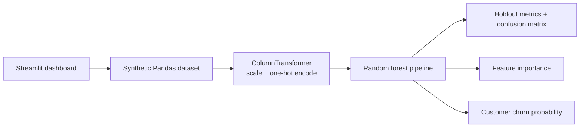

# Customer Churn Signals

A local, end-to-end classification demo. It generates reproducible synthetic customer records, preprocesses numeric and categorical inputs, trains a scikit-learn random forest, reports holdout metrics, and scores a customer in a Streamlit dashboard. No account, API key, or network connection is needed.

## Architecture



## Windows setup

From PowerShell:

```powershell
cd C:\Test_AI\GenAI-Portfolio\ml-predictor
py -3.12 -m venv .venv
.\.venv\Scripts\Activate.ps1
python -m pip install --upgrade pip
pip install -r requirements.txt
Copy-Item .env.example .env
python -m pytest
streamlit run churn_app\app.py
```

Python 3.10 or newer is required. The dashboard is available at the local URL printed by Streamlit (normally `http://localhost:8501`). If PowerShell blocks activation, use `.venv\Scripts\python.exe -m pip install -r requirements.txt` and `.venv\Scripts\python.exe -m streamlit run churn_app\app.py`.

## Data and evaluation

`churn_app/data.py` creates 600 deterministic records from a transparent synthetic churn rule. The model splits the records with stratification, fits scaling and one-hot encoding only on training rows, then reports accuracy, precision, recall, F1, ROC AUC, a confusion matrix, and transformed-feature importance on the holdout set. These are demonstration metrics on synthetic data, not evidence of real-world performance.

With the default seed and current implementation, the 150-row holdout produced accuracy `0.720`, precision `0.565`, recall `0.542`, F1 `0.553`, and ROC AUC `0.747`. The confusion matrix (actual rows: stayed, churned; predicted columns: stayed, churned) was `[[82, 20], [22, 26]]`. These measured values are reproducible demo output, not a claim about real customers.

To change the generated sample size or seed, call `generate_customer_data(n_samples=600, random_state=42)` from Python. Model logic is in `churn_app/pipeline.py`; focused tests are in `tests/`.

## Publish as its own GitHub repository

Create an empty GitHub repository, then run these commands from this folder after installing Git:

```powershell
git init
git add .
git commit -m "Build customer churn prediction portfolio project"
git branch -M main
git remote add origin https://github.com/<your-user>/<repository>.git
git push -u origin main
```

Review the staged files before committing. No repository was created or pushed by this setup.