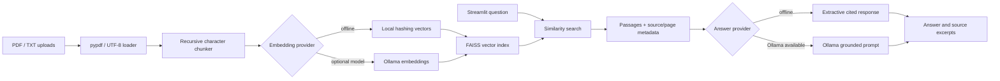

# Knowledge Desk RAG Assistant

An enterprise-style document question-answering demo. It ingests PDF and TXT files, preserves source/page metadata, chunks the text, indexes vectors in FAISS, retrieves semantically relevant passages, and returns source-cited answers. It uses Ollama for local generation when available; hashing embeddings and a concise extractive answer keep retrieval usable without Ollama or cloud credentials.

## Architecture



## Windows setup

From PowerShell:

```powershell
cd C:\Test_AI\GenAI-Portfolio\rag-assistant
py -3.12 -m venv .venv
.\.venv\Scripts\Activate.ps1
python -m pip install --upgrade pip
pip install -r requirements.txt
Copy-Item .env.example .env
python -m pytest
streamlit run rag_app\ui.py
```

Python 3.10 or newer is required. FAISS has platform-specific wheels; use a supported 64-bit Python version if package installation fails. Streamlit prints the local dashboard URL (normally `http://localhost:8501`). If PowerShell blocks activation, use `.venv\Scripts\python.exe -m pip install -r requirements.txt` and `.venv\Scripts\python.exe -m streamlit run rag_app\ui.py`.

Install [Ollama for Windows](https://ollama.com/download) and download the default chat model to enable locally generated answers:

```powershell
ollama pull llama3.2:latest
```

The app starts with `sample_docs/employee_handbook.txt` already indexed. Add one or more `.pdf` or `.txt` files in the sidebar and select **Build index from uploads** to replace the active in-memory index. Uploaded documents are not written to disk. Choose **Evaluate sample retrieval** to calculate macro recall@3 over three labeled questions against the included sample handbook.

## Providers and configuration

By default, `HashEmbeddings` uses scikit-learn's stateless `HashingVectorizer` and FAISS stores vectors locally in memory. If Ollama is running, the assistant uses `OLLAMA_MODEL` to generate grounded answers. If it is unavailable or disabled, the cited extractive fallback returns the most relevant source sentences; it does not pretend to be a generated answer. Set `OLLAMA_EMBEDDING_MODEL` to an installed embedding model to replace local hashing. Ollama runs locally and needs no API key. The base URL, chat model, and enable switch are in `.env.example`.

Chunk sizing, overlap, and top-k are configurable with `RAG_CHUNK_SIZE`, `RAG_CHUNK_OVERLAP`, and `RAG_RETRIEVAL_K`. Citations include the source filename and one-based PDF page (TXT files use page 1). Ollama responses are instructed to answer only from retrieved excerpts and cite the provided source labels. As with any LLM, validate generated claims before production use.

## Tests and evaluation

Run `python -m pytest` from this folder. Tests cover TXT/PDF ingestion, metadata retention, chunking, local FAISS retrieval, cited extractive answers, Ollama generation through a mock adapter, input validation, and recall@k. The real local model call is not required by tests. `rag_app/evaluation.py` exposes labeled-query evaluation for reuse beyond the sample UI.

Measured against the included handbook, local hashing produced 2 chunks and recall@3 was `1.00` across the 3 bundled labeled questions. Each question expects the same single handbook source, so this is only a smoke evaluation of the sample corpus, not a broad retrieval-quality benchmark. A live Ollama request also generated an answer citing `policy.txt, p. 1` in a separate in-memory test document.

## Publish as its own GitHub repository

Create an empty GitHub repository, then run these commands from this folder after installing Git:

```powershell
git init
git add .
git commit -m "Build cited Ollama RAG knowledge assistant"
git branch -M main
git remote add origin https://github.com/<your-user>/<repository>.git
git push -u origin main
```

Review staged files and verify `.env` is absent before committing. No repository was created or pushed by this setup.